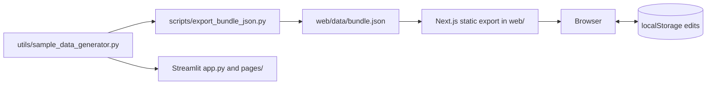

# PMO Portfolio Intelligence Dashboard

A project portfolio dashboard for PMO leads and delivery managers who want one place to see status, risk, budget, resources and priorities across a set of projects. It runs on generated sample data.

Live demo: https://pmo-dashbard.vercel.app (static site, sample data only)

## What it does

- **Home and executive views:** portfolio KPIs, projects by status, budget against actual, delivery progress and strategic alignment charts.
- **Portfolio, risk, resources, prioritisation, milestones, weekly reports and predictive pages,** each built from the same project data.
- **Data / Admin page:** add, edit or delete projects in the browser, export the portfolio, or reset to the shipped sample.
- **Legacy Streamlit app** with the same pages, for running locally or in Docker.

## How it works



Python generates a seeded sample portfolio (35 projects, 167 milestones, 185 resource rows, 210 weekly updates in the committed bundle). The export script writes it to `web/data/bundle.json`. The Next.js app is a static export with no server, so edits made on the Admin page live only in that browser's localStorage.

## Quick start

Web dashboard (Node 20 or later):

```bash
cd web
npm ci
npm run build    # writes the static site to web/out
npm run dev      # development server; open the address it prints
```

Regenerate the sample data (Python 3.11 or later):

```bash
python3 -m venv .venv
.venv/bin/pip install -r requirements.txt
.venv/bin/python scripts/export_bundle_json.py
```

The generator is seeded, but project dates are relative to the day you run it, so a fresh export changes most date fields in `bundle.json`.

Legacy Streamlit app:

```bash
.venv/bin/streamlit run app.py
```

Docker runs the Streamlit app: see `Dockerfile` and `docker-compose.yml`.

## Verified run (1 November 2026, Linux, Python 3.11, Node 20)

| Check | Result |
| --- | --- |
| `pytest -q` | 5 passed |
| `ruff check` (default rules) | 12 style findings (one line `if` statements in `utils/data_loader.py`) |
| `npm run lint` in `web/` | no warnings or errors |
| `npm run build` in `web/` | ok, 11 static routes |
| `export_bundle_json.py` | ok; output differs from the committed bundle only in dates |
| Streamlit `app.py` headless | server starts, health check ok (pages not clicked through) |
| Live Vercel site | responds 200 |
| CI | none |

## Deploying to Vercel

Two layouts work:

- **Repo root (current):** leave Root Directory empty. The root `vercel.json` runs `cd web && npm ci && npm run build` and publishes `web/out`. If Vercel picks up the Python files, set Framework Preset to Other.
- **`web` as root:** set Root Directory to `web` and use the default Next.js preset.

To change the default data for everyone, run the export script, commit `web/data/bundle.json` and redeploy.

## Structure

| Path | What it is |
| --- | --- |
| `web/` | Next.js 14 app, static export (main version) |
| `web/data/bundle.json` | the data the web app ships with |
| `app.py`, `pages/`, `components/` | Streamlit multipage app (legacy) |
| `utils/` | shared Python logic: sample data, metrics, risk, prioritisation, reporting |
| `scripts/export_bundle_json.py` | regenerates the web bundle |
| `tests/` | pytest tests for metrics, risk logic and project admin |
| `vercel.json`, `render.yaml`, `Dockerfile` | deployment configs |

## Configuration

There are no secrets or environment variables. Streamlit theme settings are in `.streamlit/config.toml`. The amount of sample data is set by `generate_sample_data(n_projects=35, seed=42)` in `utils/sample_data_generator.py`.

## Limitations

- All data is generated. It is not connected to any real PMO tool or feed.
- Edits on the web Admin page are per browser and are lost if localStorage is cleared.
- The Streamlit and Next.js versions are maintained separately and can drift.
- Nothing is actually predicted. The Streamlit predictive page applies a fixed formula (a logistic curve over a hand weighted risk score in `pages/8_Predictive_Analytics.py`), and the web page shows illustrative summaries of the sample data. No model is trained and no accuracy has been measured.
- No CI.

## Status

Working demo. The web version is the one kept up to date. Not used by any real organisation.

See [FAILURES.md](FAILURES.md) for what can go wrong and what has been fixed.

## Licence

MIT. See [LICENSE](LICENSE).

More of my work: https://cv.omnitest.dev/
